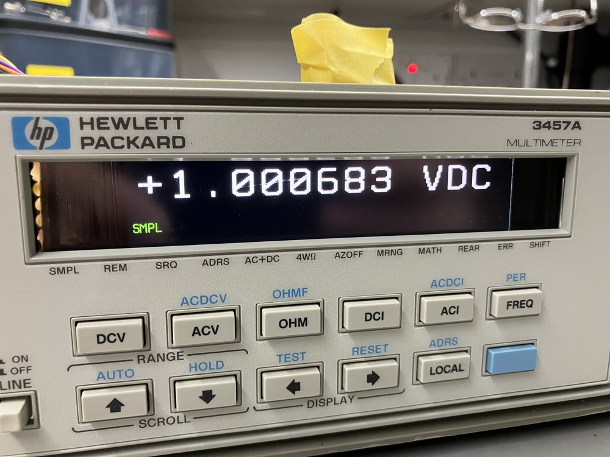

# HP 3457A TFT Display Upgrade (Visual Studio 2022)

HP 3457A DMM LCD reverse engineered and now with ability to drive a 240x960 TFT LCD.

Visual Studio 2022 / VisualGDB and then convert to 240x960 TFT LCD.

The .HEX file is located in /VisualGDB/Debug

Uses VisualGDB available here:
https://visualgdb.com

## Notes
1. Function prototypes in the headers are missing, I couldn't be bothered! VS2022 seems to compile just fine and produce working code without them.

## Webpage
https://www.ianjohnston.com/index.php/conversions/video-blog-175-3457a

## Display hardware

- Levetop LT7680A-R controller (128Mb built-in SDRAM), driven by STM32 SPI1.
- BuyDisplay/EastRising ER-TFT3.71-1, 240x960, ST7701S driver.

## Fixes - November 2026 (random pixels and display area alignment)

1. SDRAM auto-refresh was never switched on (main cause of the random pixels). `SDRAM_Init_LT()` no longer sets REG[E4h] bit 2 first, so E0h-E3h now get the attribute, CAS latency and refresh interval.
2. The Active Window was one pixel short in each direction. `ConfigureActiveDisplayArea_LT()` now writes the width and height (240x960) instead of size-1. The boot edge wipe in main.c is no longer needed and is commented out.
3. LT7680 busy and write-FIFO waits added to `DrawText()`, `SetTextColors()`, `ConfigureFontAndPosition()` and `DrawLine()`. `DrawLine()` now waits for each line to finish. All waits have timeouts.
4. A commented-out 1-pixel test box around the full 240x960 frame is in main.c for checking alignment.

Full details are in ReadMe.txt.

Ian.
